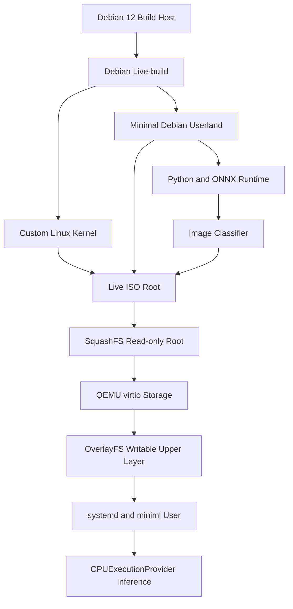

# MiniML Linux Architecture

The ISO contains a read-only root filesystem. Live-boot supplies a writable upper layer. The application runs as `miniml`, and ONNX Runtime restricts execution to `CPUExecutionProvider`.
